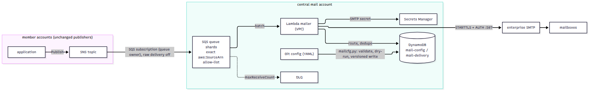

# Amazon SNS email notifications through enterprise SMTP

Replace SNS email subscriptions with Amazon SQS, Lambda and enterprise SMTP, using DynamoDB recipient configuration without changing publishers.

> **Disclaimer**: This repository is provided as an example only and is NOT
> intended for production use. You are responsible for testing, securing, and
> optimizing the code as appropriate for production grade use based on your
> specific quality control practices and standards.

[中文说明](README_CN.md)

## Architecture



(Diagram source: [`docs/architecture.mmd`](docs/architecture.mmd).)

Member-account SNS topics deliver to central encrypted SQS queues. A Lambda function in private VPC subnets
reads recipient configuration from DynamoDB and submits mail over STARTTLS and SMTP AUTH with certificate
verification. The design supports multiple accounts in the `aws` and `aws-cn` partitions; an optional
Postfix host provides a local mail store for testing without external delivery.

## Prerequisites

- Python 3.10+ (the tools use boto3 and PyYAML from `requirements.txt`) and AWS CLI v2.
- AWS CLI profiles for the central account and each member account. ARNs are partition-aware: use
  `arn:aws-cn:` in China.
- Operators running `tools/` against DynamoDB need `kms:Decrypt` on the data key; see the [IAM example](SECURITY.md#customer-managed-key-and-access-paths).
- **A route from the mailer subnets to your SMTP server.** `central.yaml` creates a new private VPC.
  `SmtpCidr` only opens the security group; it does not create connectivity. Add the path your network
  team uses, such as a Transit Gateway attachment, VPN, Direct Connect or VPC peering, plus routes in
  `PrivateRouteTableId`. Make `SmtpHost` resolvable from the VPC, for example with a Route 53 Resolver
  outbound rule for the corporate DNS zone. The template does not take an existing VPC or subnets: to use
  them, replace its network section and keep the two endpoints.
- An SMTP account that may submit mail as `MailFrom`, and its CA certificate if the server's certificate
  is not publicly trusted.

## AWS Services Used

- Amazon SNS (the existing topics) and Amazon SQS (queue shards and dead-letter queues)
- AWS Lambda (the mailer, in an Amazon VPC with a DynamoDB gateway endpoint and a Secrets Manager interface endpoint)
- Amazon DynamoDB (routing configuration, migration state, delivery records)
- AWS Secrets Manager (SMTP credentials and CA certificate)
- AWS KMS (customer managed data encryption key)
- Amazon CloudWatch (logs, metric filters, alarms), AWS CloudFormation, AWS IAM, Amazon S3 (code artifact)
- For the optional test SMTP host only: Amazon EC2, AWS Systems Manager, Amazon SES (`DeliveryMode=ses`)

## Deployment

Use `NamePrefix` (default `sample-sns-email`) and the same `--prefix` for `package` and `cleanup.py` if
you change it. Unknown parameter names are refused.

```sh
git clone https://github.com/aws-samples/sample-sns-email-notification-china-region.git
cd sample-sns-email-notification-china-region
python3 -m pip install -r requirements.txt
python3 -m unittest discover -s tests
# 1. member account(s): CreateDemoTopics=true only for a trial
python3 scripts/deploy.py --profile MEMBER --region REGION stack sample-sns-email-member templates/member.yaml \
    CentralAccountId=<central-account-id> CreateDemoTopics=true
# 2. central account
python3 scripts/deploy.py --profile CENTRAL --region REGION package        # prints CodeBucket / CodeKey
python3 scripts/deploy.py --profile CENTRAL --region REGION stack sample-sns-email-central templates/central.yaml \
    CodeBucket=<bucket> CodeKey=<key> "Shard1TopicArns=<topic-arn>,<topic-arn>" \
    SmtpHost=<smtp-host-in-certificate> SmtpCidr=<smtp-network> MailFrom=<allowed-sender>
# FunctionTimeoutSeconds >= 30 (the mailer keeps 12 s back before each recipient);
# QueueVisibilityTimeoutSeconds >= 6 x FunctionTimeoutSeconds
# 3. SMTP credentials: put {"username": ..., "password": ...} into the <prefix>/smtp secret (the stack generates
#    a password for the test server), and the CA's PEM into <prefix>/smtp-ca if it is not publicly trusted.
# Optional test SMTP in the central VPC (then update the central stack with SmtpHost = its output):
python3 scripts/deploy.py --profile CENTRAL --region REGION stack sample-sns-email-test-smtp templates/test-smtp.yaml \
    VpcId=<out> LambdaSecurityGroupId=<out> EndpointSecurityGroupId=<out> SmtpSecretArn=<out> SmtpCaSecretArn=<out> \
    DataKeyArn=<central-DataKeyArn-output> DeliveryMode=store
```

The test SMTP stack requires `DataKeyArn`: use the central stack's `DataKeyArn` output when creating or updating it.

The Lambda security group allows only SMTP (`SmtpPort`) to `SmtpCidr`, HTTPS to the security group of the Secrets Manager
interface endpoint, and HTTPS to the AWS managed prefix list of the DynamoDB gateway endpoint (`DynamoDbPrefixListId`);
it has no `0.0.0.0/0` rule. `scripts/deploy.py` looks the prefix list up (`com.amazonaws.<region>.dynamodb`, the same name
pattern in `aws` and `aws-cn`). If you call CloudFormation yourself, pass it:
`aws ec2 describe-managed-prefix-lists --filters Name=prefix-list-name,Values=com.amazonaws.<region>.dynamodb --query 'PrefixLists[0].PrefixListId'`.
If you add endpoints for other services later, add a matching egress rule for each.

To test SMTP connectivity without real mail, use `DeliveryMode=store`. `DeliveryMode=ses` relays through
Amazon SES and is available only in the `aws` partition; in China Regions use `store` (the template rejects `ses` there).
It calls SES with the host's instance role, so no SES SMTP credentials are needed. The test host still reads the central SMTP
secret and keeps the inbound AUTH credential of the mailer in `/etc/sasl2/sasldb2` (the secret stays in Secrets Manager). In the SES sandbox, verify the sender
domain (with DKIM) and every recipient first.

## Usage

After deployment, you manage recipients as configuration and move topics over one batch at a time.

### Delivery behavior

- **No publisher change.** Raw message delivery stays off, so every SQS message is the SNS envelope:
  `TopicArn`, `MessageId`, `Subject` and `Message`. The `TopicArn` is the routing key, which replaces the
  per-subscription email endpoint.
- **Queue-owner subscription.** The central account creates the SQS subscription, so no confirmation
  step is needed. Each topic only has to allow `sns:Subscribe` from the central account. A topic has a
  single policy document: add the statement in the template that already owns the topic. A second
  stack would overwrite the whole policy.
- **Two allow-lists.** First, the queue policy accepts `sqs:SendMessage` from SNS only for the exact
  topic ARNs listed for that shard. Second, a topic must be present in `mail-config` with `mode` set to
  `shadow` or `live`.
  - A queued message whose topic is unknown to `mail-config`, switched off or without recipients is never
    dropped silently. It goes back to SQS, lands in the DLQ and raises the `config-missing` alarm.
  - A message from a topic that is not in the queue policy is refused before it is queued, so it never reaches
    this queue or its DLQ; watch the topic's SNS delivery-failure metrics instead.
  - SQS queue policies are limited to 8 KiB, so keep about 60 topic ARNs per shard and add shards as
    the estate grows.
- **Routing data.** `mail-config` holds two kinds of item:
  - `TOPIC#<arn>`: `mode` (`off` / `shadow` / `live`), `recipients`, `groups`, `format` (`text`, or
    `json` for email-json behaviour), `defaultSubject`, `ownerTeam` and `version`;
  - `GROUP#<name>`: the members of a recipient group.

  Each item has a `CURRENT` row and immutable `V#n` history rows. The function reads it with eventually
  consistent reads and caches it for 60 seconds, so a change takes effect within about a minute and
  needs no redeploy.
- **Idempotency.** For every (SNS `MessageId`, recipient) pair, the function writes a conditional
  `claimed` record with a lease into `mail-delivery`, sends the mail, then marks it `sent`. Records
  expire through TTL after 30 days.
  - A redelivered or replayed message skips recipients that already have a terminal record: `sent`,
    `rejected` or `shadow`. The key is the (SNS `MessageId`, recipient) pair only; it does not include the
    mode or the configuration version. A `shadow` record therefore also makes a replay of the same message
    skip that recipient after the topic goes `live`. Going live, rolling back and a normal redrive do not
    reset these records, and you should not delete them by hand.
  - After a temporary failure, the claim is released (best effort), and the retry skips the terminal
    records and tries the other recipients again, including one whose send outcome was not confirmed.
  - A recipient can be mailed twice when the outcome is uncertain: the SMTP server accepted the message but
    the final reply was lost (timeout or disconnect); the function stopped before the `sent` record was
    written; or writing the record or releasing the claim failed, in which case the retry waits for the lease
    to expire. Delivery is at-least-once.
- **Failures.**
  - Connection errors, timeouts and SMTP 4xx replies are reported as batch item failures
    (`ReportBatchItemFailures`). SQS retries them up to `maxReceiveCount` times, then moves them to
    the DLQ.
  - An SMTP 5xx reply for a recipient is recorded as `rejected`, is not retried, and raises an alarm: the `mail_rejected` event (no address, no SMTP reply) is logged as soon as the record is written, even if a later recipient of the same message fails and the message is retried.
  - The Lambda function never logs message bodies, addresses or SMTP replies. The test SMTP host keeps
    addresses in its log and message bodies in its spool, owner-readable only.
- **Throttling.**
  - `MaxConcurrencyPerShard` sets the event source mapping's maximum concurrency.
  - `ReservedConcurrency` caps the number of SMTP sessions.
  - `MaxSendsPerSecond` limits the sends of each execution environment; its consecutive invocations share the limit, and concurrent environments each have their own, so the total is the rate times the number of environments (the first send of a new environment is not delayed).

### Recipient configuration as code

`config/examples/mail-config.example.yaml` shows the format. The workflow:

```sh
python3 tools/mailcfg.py validate mail-config.yaml
python3 tools/mailcfg.py --profile CENTRAL --region REGION plan  mail-config.yaml --table sample-sns-email-mail-config
python3 tools/mailcfg.py --profile CENTRAL --region REGION apply mail-config.yaml --table sample-sns-email-mail-config --from-git --execute
python3 tools/mailcfg.py --profile CENTRAL --region REGION history  --table ... --key "TOPIC#<arn>"
python3 tools/mailcfg.py --profile CENTRAL --region REGION rollback --table ... --key "TOPIC#<arn>" --to-version 2 --execute
```

- **Validation** checks topic ARNs and addresses (full match; a line break is refused), `allowedDomains`, a limit of 50 recipients per topic
  (use groups for more), known groups (`groups` must be a list of names) and modes, and line breaks in subjects. Missing items are never
  deleted: switching a topic off is `mode: "off"` (quoted: a bare `off` is YAML false).
- **apply** writes `V#n+1` and `CURRENT` in one transaction, conditional on the version that was
  planned. A concurrent publish therefore fails instead of overwriting.
  - `--from-git` accepts only a file that Git tracks and has no uncommitted changes. It reads the committed
    blob at `HEAD` and parses, plans and publishes exactly those bytes, so the file cannot change between the
    check and the publish. It records the file's last commit as `changeId`.
- **rollback** writes the old content as a new version, so the history stays linear.

Run `apply` from your CI pipeline after review, with a role that is the only writer of the table.

### Migration runbook

Run the steps per topic, in batches, with central-account credentials. Every write to AWS is a dry run unless
`--execute` is given; run each command once without it and read the output first. `plan` has no `--execute`:
it always creates or overwrites the local `--out` file, so give it a path that does not hold a file you edited by hand.

```sh
A="--profile CENTRAL --region REGION"; P=sample-sns-email
MIG=$P-mail-migration; CFG=$P-mail-config; DEL=$P-mail-delivery
INV=arn:aws:iam::<member-account-id>:role/$P-inventory; MR=arn:aws:iam::<member-account-id>:role/$P-migration
Q=arn:aws:sqs:REGION:<central-account-id>:$P-s1; T=arn:aws:sns:REGION:<member-account-id>:<topic>

python3 tools/migrate.py $A inventory --table $MIG --inventory-role $INV --execute                      # 1
python3 tools/migrate.py $A plan --table $MIG --out mail-config.yaml                                     # 2
#   review, commit, then: python3 tools/mailcfg.py $A apply mail-config.yaml --table $CFG --from-git --execute
python3 tools/migrate.py $A subscribe --table $MIG --inventory-role $INV --queue-arn $Q --topic $T --execute   # 3
SINCE=$(date -u +%FT%TZ)    # shadow window starts; let the topic's normal traffic flow
python3 tools/migrate.py $A verify --table $MIG --delivery-table $DEL --config-table $CFG --topic $T --since $SINCE --mark shadow-verified --execute   # 4
#   publish mode: live with mailcfg.py, then after the first messages:
LIVE=<time the live config was published>
python3 tools/migrate.py $A verify --table $MIG --delivery-table $DEL --config-table $CFG --topic $T --since $LIVE --mark live --execute   # 5
python3 tools/migrate.py $A remove-email --table $MIG --config-table $CFG --delivery-table $DEL --migration-role $MR --topic $T --execute
python3 tools/migrate.py $A status --table $MIG
```

1. **Inventory** writes every email / email-json subscription into `mail-migration`, including pending
   ones, filter policies and filter policy scopes, and the confirmed state.
2. **Plan** turns the confirmed subscriptions into configuration with `mode: shadow`. Pending subscriptions
   are left out for their owners to decide. A topic whose subscriptions the new path cannot reproduce
   exactly blocks the plan: email and email-json on the same topic, or different filter policies or
   scopes. Split or exclude those subscriptions first.
3. **Subscribe** creates the SQS subscription as the queue owner, with raw delivery off and the email
   subscription's filter policy and scope. If an SQS subscription already exists with other attributes,
   it is refused. Register the topic ARN in the shard's queue policy (the `Shard1TopicArns` parameter)
   first.
4. **Shadow.** While the topic is in shadow mode, the function resolves and records the recipients but
   sends nothing; the legacy email subscription still delivers. `verify --mark shadow-verified` checks
   that every legacy recipient was resolved by the new path since `--since`.
5. **Live.** `verify --mark live` requires a `sent` record for **every legacy recipient** under the
   configuration version that is live now, since `--since`. Shadow records and mail to other recipients
   do not count, and every legacy recipient must still be in the topic's recipients or its groups. It
   stores the versions of the topic and of every group it references. `remove-email` resolves them again
   and refuses if any of them changed or a legacy recipient is no longer routed. Between going live and
   removal, recipients can get the same message twice for a few minutes; that is preferred over a gap.
   Before `remove-email`, set the member stack's `MigrationTopicArns` to the exact target topic ARNs (empty by default).
6. **Rollback.** Before removal, set `mode: shadow` and the legacy subscription keeps delivering. After
   removal, roll back inside the new path only:
   - restore an earlier configuration version with `mailcfg.py rollback`;
   - point the function back to an earlier version;
   - redrive the DLQ with `aws sqs start-message-move-task`; the delivery table prevents duplicates.

   **In regions that no longer accept email subscriptions (AWS China today), a removed email
   subscription cannot be recreated.**

### Limits

- At-least-once delivery, with the duplicate window described above. The `Message-ID` header is
  `<sns-message-id>.<recipient-hash>@<sender-domain>`, which lets mailboxes and SMTP servers correlate
  duplicates.
- Plain text and email-json bodies are supported; the SNS email footer and unsubscribe link are not
  reproduced. Subjects are cut to 100 characters. Messages are at most 256 KB (SNS limit).
- The `verify` and `remove-email` checks scan the delivery table, which is fine for a sample. At scale,
  use a GSI or log metrics instead.
- The test SMTP host is not a production MTA: it has a self-signed CA valid for 30 days and a public
  subnet, used for package installation and the SES API only.

## Cost

Costs depend on usage; see the AWS pricing pages for [SNS](https://aws.amazon.com/sns/pricing/), [SQS](https://aws.amazon.com/sqs/pricing/), [Lambda](https://aws.amazon.com/lambda/pricing/), [DynamoDB](https://aws.amazon.com/dynamodb/pricing/), [KMS](https://aws.amazon.com/kms/pricing/) and [Secrets Manager](https://aws.amazon.com/secrets-manager/pricing/).

## Cleanup

```sh
python3 scripts/cleanup.py --region REGION --central-profile CENTRAL --member-profile MEMBER             # dry run: prints the plan
python3 scripts/cleanup.py --region REGION --central-profile CENTRAL --member-profile MEMBER --execute
```

Add `--prefix` if your stack names do not start with `sample-sns-email`. The script finds the stacks by name
and takes the tables and the artifact bucket from the central stack (its table resources and `CodeBucket`
parameter). It deletes:
- the stacks;
- the two tables the central stack retains (`mail-config`, `mail-migration`);
- the artifact bucket.

Record the central stack's `DataKeyArn` before cleanup. The KMS key is retained when the stack is deleted; schedule its deletion separately once no retained data needs it (see [Security](SECURITY.md#upgrade-retention-and-cleanup)).

Each of them must carry the tag `project=sample-sns-email`, checked again right before every change
(deletion protection off, delete, every batch of objects removed from the bucket, and the bucket's own
deletion). Otherwise the script stops and changes nothing more. It also stops on any lookup error other than
"stack does not exist" (for example access denied), and it prints `skipped` for an action that found nothing
to do instead of `done`. The check and the change are separate calls, so a tag removed in between is not caught.

If you used `DeliveryMode=ses`, also delete what you created for SES:
`aws sesv2 delete-email-identity` for the sender domain and the verified recipients,
`aws sesv2 delete-configuration-set`, and the DKIM CNAME records in your DNS zone.

## Security

See [CONTRIBUTING](CONTRIBUTING.md#security-issue-notifications) for reporting security issues and
[SECURITY.md](SECURITY.md) for security boundaries, permissions and operational responsibilities.

## Disclaimer

The sample code; software libraries; command line tools; proofs of concept; templates; or other related technology
(including any of the foregoing that are provided by our personnel) is provided to you as AWS Content under the AWS
Customer Agreement, or the relevant written agreement between you and AWS (whichever applies). You should not use
this AWS Content in your production accounts, or on production or other critical data. You are responsible for
testing, securing, and optimizing the AWS Content, such as sample code, as appropriate for production grade use
based on your specific quality control practices and standards. Deploying AWS Content may incur AWS charges for
creating or using AWS chargeable resources, such as running Amazon EC2 instances or using Amazon S3 storage.

## License

This library is licensed under the MIT-0 License. See the [LICENSE](LICENSE) file.
